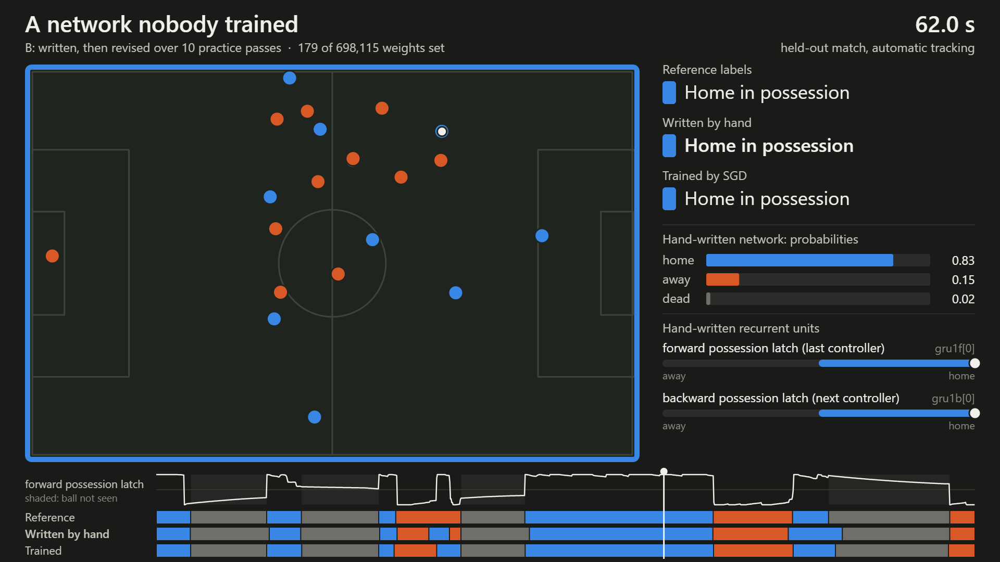
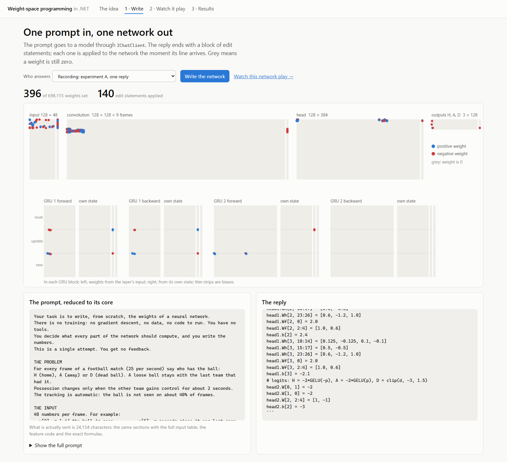

# Weight-space programming, in .NET

**What if a language model wrote a neural network's weights instead of training it?**

A network that says who has the ball in a football match normally learns that from millions of
labelled frames. Here a language model got a description of the task and of the network, with
every weight at zero, and replied with the weights as text. Nothing was trained. This repository
holds the experiment, and a .NET app that sends the prompt, turns the reply into a network, runs
it in plain C# and shows what it does.



| spellF1 on held-out matches | DFL | SkillCorner | Metrica g3 | weights set |
|---|---|---|---|---|
| Nearest player + 4 s vote (no network) | 0.202 | 0.318 | 0.416 | – |
| **A — written in one reply, no data** | **0.378** | **0.471** | **0.546** | 396 |
| **B — written, then revised over 10 practice passes** | **0.405** | **0.547** | **0.784** | 179 |
| Trained by gradient descent, one model | 0.724 | 0.726 | 0.842 | 698,115 |

The hand-written networks beat the rule baseline everywhere and get close to the trained one
where the ball is visible. They do not beat training. The whole account, including what went
wrong, is in [experiment/REPORT.md](experiment/REPORT.md).

The method follows *Sparks of Weight-Space Programming* (Takehi, Teoh, Zhang, Khattab):
[post](https://rikiyat.github.io/blog/weight-space-programming/).

## Run it

Needs the .NET 10 SDK. Nothing else: the recorded replies, the networks and a 100-second clip are
in the repository.

```bash
dotnet test                                                  # 19 tests, including parity with PyTorch
dotnet run --project src/WeightSpace.Cli -- run expB          # run a network on the clip, in the console
dotnet run --project src/WeightSpace.Web                      # the app; open the URL it prints
```

The app has three steps:

1. **Write** — the prompt goes to a model through `IChatClient`; as the reply streams in, each edit
   statement is applied and the weights it sets light up on a map of all 698,115.
2. **Watch it play** — the pitch replay above: players, ball, the reference labels, the
   hand-written network's labels and the trained network's, with the hand-written recurrent units
   moving live. **Record video** saves it as an MP4 for a slide.
3. **Results** — the benchmark chart and the score after each round of feedback.



## The .NET in it

**The model is an `IChatClient`** (`Microsoft.Extensions.AI`). Three ways to answer plug in the
same way:

```csharp
IChatClient client = new ReplayChatClient(Repo.Reply("expA_scratch_oneshot", 0));   // a recorded reply
IChatClient client = new ClaudeCliChatClient(effort: "medium");                      // Claude, tools off, no API key
// ... or any other IChatClient: OpenAI, Azure OpenAI, Ollama, Semantic Kernel's adapters

var network = new Network();                                  // 698,115 weights, all zero
await foreach (var e in new WeightWriter(client).WriteAsync(prompt, network))
    if (e is WriterEvent.Edit edit)
        Console.WriteLine($"{edit.Outcome.Text}  ->  {edit.NonZeroWeights} weights set");
```

`WeightWriter` applies the reply's `edits` block statement by statement while the text is still
arriving. The reply is never executed: a regular expression reads the left side of a statement and
a small parser accepts numbers and lists of numbers on the right.

```
inp.W[0, 13] = -11.43              # unit 0 reads the distance of the nearest home player
conv.W[20, 0, :] = 0.027778        # unit 20 averages unit 0 over 9 frames
gru1f.Wiz[2, 20:22] = [-24, -24]   # the update gate of recurrent unit 2 opens on sustained control
```

**The network runs in plain C#** (`src/WeightSpace.Core/PossessionNet.cs`): a linear layer, a
convolution over 9 frames, two layers of bidirectional GRU, a head, then a Viterbi decoder. Dense
rows use `System.Numerics.Tensors.TensorPrimitives.Dot`; rows with a handful of weights are short
index lists; units with nothing set are skipped, which is exact for this architecture. Four views
of 4,500 frames take about 120 ms. The tests check the probabilities against PyTorch on the same
input (difference below 0.001) and the decoded labels exactly.

**The recorded replies are the source of truth.** A test streams each recorded reply through
`IChatClient` and asserts that the result is the stored network, weight for weight. That test
found a bug in the original Python harness: see "One weight" below.

## ONNX

`data/onnx/` holds the same architecture as ONNX, exported from PyTorch by `tools/export_onnx.py`:

- `expA.onnx`, `expB.onnx`: the two hand-written networks as self-contained files. Open one in
  [Netron](https://netron.app) to see the graph; any ONNX runtime can run them.
- `possessionnet.onnx`: the architecture with every weight zero and its 24 weight tensors declared
  as graph inputs, so one file can run any network by feeding the weights next to the frames.

The export script checks all three against PyTorch with ONNX Runtime in Python (difference about
1e-6 for A, 2.5e-5 for B). **The .NET app does not use them yet**: it runs the plain C# forward
pass above. Wiring `Microsoft.ML.OnnxRuntime` into the app is the open item.

## For a talk

Everything a slide needs is in [`media/`](media) and [`prompts/`](prompts); a suggested storyline
is in [TALK.md](TALK.md).

| asset | what it is |
|---|---|
| `media/replay-expB-dark.mp4`, `-light.mp4` | the pitch replay of network B, 100 s, 1920 × 1080 |
| `media/replay-expA-dark.mp4`, `-light.mp4` | the same for network A (one reply, no data): visibly worse, which is the point |
| `media/replay-*.png` | stills of the replay |
| `media/weights-expA.png`, `weights-expB.png` | the weight map after writing: almost everything grey |
| `media/page-*.png` | the app's pages |
| `/charts/results.svg`, `/charts/passes.svg` | the charts as vector files, from the running app (`?theme=dark` for a dark slide) |
| `prompts/01…03-*.md` | the three prompts reduced to their core ideas, sized for a slide |

To make them again, start the app on port 5199 and run `node tools/capture/capture.mjs shots` or
`videos` (uses the installed Edge or Chrome).

## What is where

```
src/WeightSpace.Core     the network, the edits language, the decoder, the clip          no dependencies but System.Numerics.Tensors
src/WeightSpace.AI       ReplayChatClient, ClaudeCliChatClient, WeightWriter             Microsoft.Extensions.AI.Abstractions
src/WeightSpace.Web      the Blazor app; charts are SVG built in C#, canvases are small JS modules
src/WeightSpace.Cli      run a network, or write one, from the console
tests/                   parity with PyTorch, the parser, replaying the recorded replies
prompts/                 the prompts reduced to their core ideas
data/networks/           the hand-written networks as sparse JSON (A is 10 KB, B is 4 KB)
data/clip/               100 s of a held-out half: positions, labels, the network's input
data/reference/          PyTorch's output on that input
experiment/              the experiment itself: report, journal, every prompt and reply, the Python harness
tools/                   the Python export script and the screenshot / video capture
```

## What this is not

- **Not a better model.** Training wins on every source, by a lot where the ball is hidden.
- **Not a full .NET pipeline.** The 48 input features of the clip were computed by the
  experiment's Python code and are stored; the C# side starts from them.
- **One run per experiment.** A second reply to the same prompt would be a different network.
- **One weight.** Experiment B's run was interrupted once and its driver applied one reply twice,
  so one bias in the scored network is −1.525 where the replies say −1.825. The stored network is
  the one that was scored; `tests/…/ReplayTests` pins the difference to exactly that weight, and
  scored as written the network gets 0.402 / 0.549 / 0.783 instead of 0.405 / 0.547 / 0.784.
- **Editing a trained network found nothing.** In a third experiment the model analysed the
  trained weights for 24 turns, tested six candidate edits and left the network untouched.

## Credits

See [NOTICE.md](NOTICE.md): the paper this follows, Metrica Sports' sample data (the clip), the
data sources behind the benchmark, and the hackathon the task comes from. Code under the
[MIT licence](LICENSE).
