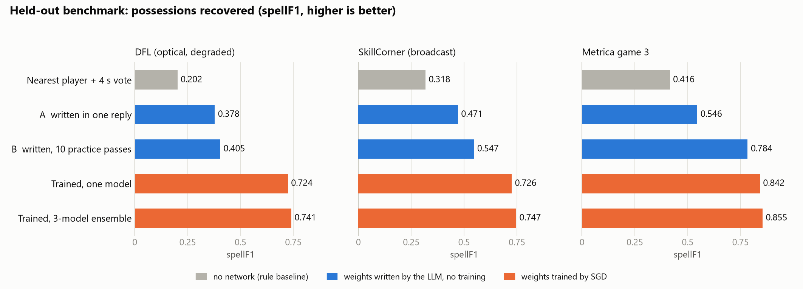
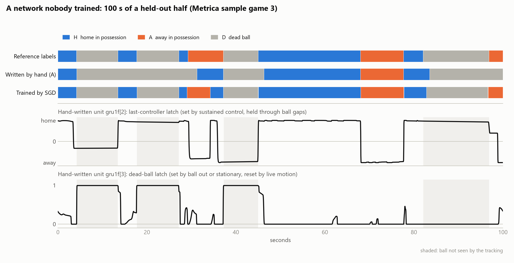
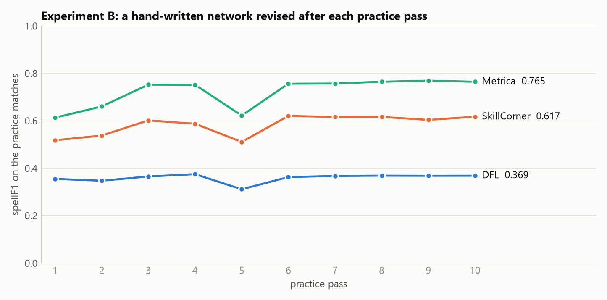

# Writing a possession network by hand: weight-space programming on our model

*Team Sigue, More than a Hack 2027. Branch `weight-space-programming`, November 2026.*

## In short

We asked a language model to do what gradient descent normally does: produce the weights of our
possession network. It had no tools and no code to run, only a description of the task and of the
network. The networks it wrote set a few hundred of the 698,115 weights and run through our
unchanged pipeline.



| spellF1 on the held-out benchmark | DFL | SkillCorner | Metrica g3 | weights set |
|---|---|---|---|---|
| Nearest player + 4 s vote (no network) | 0.202 | 0.318 | 0.416 | – |
| **A — written in one reply, no data** | **0.378** | **0.471** | **0.546** | 396 |
| **B — written, then revised over 10 practice passes** | **0.405** | **0.547** | **0.784** | 179 |
| Trained by SGD, one model | 0.724 | 0.726 | 0.842 | 698,115 |
| Trained by SGD, 3-model ensemble (our recipe) | 0.741 | 0.747 | 0.855 | 3 × 698,115 |

- **A hand-written network works.** Written in one reply with no data at all, it beats the
  baseline on every source by 0.13 to 0.18.
- **Feedback helps a lot, unevenly.** With ten rounds of scores and error excerpts from practice
  matches, a 179-weight network reaches 0.784 on Metrica, within 0.06 of the trained model. On
  DFL it reaches 0.405, barely above the one-shot network.
- **Neither beats training.** Our submission is unchanged.
- **Editing the trained network found nothing to fix.** The model analysed the trained weights
  for 24 turns, tested six candidate edits, and concluded that none of them helps. It left the
  network untouched and said so.

## The idea

*Sparks of Weight-Space Programming* (Takehi, Teoh, Zhang and Khattab, MIT CSAIL —
[post](https://rikiyat.github.io/blog/weight-space-programming/),
[logs](https://github.com/RikiyaT/lm_understand-logs)) reports that a frontier LLM can read and
write neural-network weights directly. Given the rules of a small game and the shape of a policy
network whose weights all start at zero, the model replied with the weights, and the network
played. It also repaired a failing trained network by editing 3.5% of its weights. No gradients
were involved; the model reasoned about what each unit should compute.

Our question: does that carry over to a real sequence-labelling problem with noisy inputs, a
recurrent network, and a metric that is hard to game?

## Setup

**The task.** For every frame of a match, say who has the ball: `H`, `A`, or `D` for dead ball.
The input is automatic tracking in which the ball is unseen on about 40% of frames. Entries are
ranked on spellF1, which counts whole possessions recovered, so both flicker and merging cost.

**The network.** `PossessionNet(48, 128)` from `solution/model.py`, exactly the architecture we
trained: a linear layer on 48 per-frame features, a 9-frame convolution, a two-layer bidirectional
GRU, and a head with three outputs, followed by our Viterbi decoder. Because a hand-written
checkpoint has the same file format as a trained one, the comparison is like for like: same
features, same decoder, same four-view averaging, same benchmark.

**Writing weights.** The model ends its reply with a block in a small edits language, taken from
the paper. Every weight starts at 0 and the block sets the ones it needs:

```
inp.W[0, 0] = 6              # unit 0 of the first layer reads feature 0 (ball seen)
inp.W[0, 13] = -11.43        # ... and feature 13 (distance of the nearest home player)
conv.W[20, 0, :] = 0.027778  # unit 20 averages unit 0 over 9 frames
gru1f.Wiz[2, 20:22] = [-24, -24]   # the update gate of recurrent unit 2 opens on units 20, 21
```

**The protocol.** Each turn is one headless `claude -p` call (model `claude-fable-5-2`) with every
tool switched off, started from an empty folder with a one-line system prompt. The session itself
reports `tools: []`, and every `run.json` records that as `audit.tool_free`. The writer knows only
what the prompt says. For each turn we keep the prompt, the reply, the event stream and the token
counts. The model's reasoning is not exposed by the CLI, so unlike the paper's logs ours contain
no reasoning summaries.

**Two splits, external data only.** Final numbers come from the fixed held-out benchmark of
`docs/TECHNICAL.md` (DFL matches 5–6 degraded, SkillCorner 15–19, Metrica sample game 3), which no
writer ever sees. Feedback, where an experiment allows it, comes from a separate `dev` split. The
provided match is in no prompt and no feedback.

**Check that the numbers are comparable.** Our evaluator reproduces the published ensemble scores
on this machine exactly: 0.741 / 0.747 / 0.855.

## Experiment A — a network written in one reply

*Paper's Exp. 5. Logs: `runs/expA_scratch_oneshot/turn_00/`.*

**The prompt** (24,154 characters, `prompt.txt`) has the paper's section order:

1. The task: write the weights, no training, one attempt, no feedback.
2. The problem: the possession rules from `CHALLENGE.md`, what automatic tracking looks like, and
   `solution/features.py` verbatim as the reference implementation of the input.
3. The input: a table of the 48 features with their formulas and analytic ranges. No statistics
   from data.
4. The output: three logits, and exactly how they are used — four-view averaging, then a decoder
   that charges 16 for an H↔A switch and 24 for alive↔dead.
5. The network: the formulas, including the GRU gate equations, and every tensor by name.
6. Scoring: spellF1 and macroF1 on held-out matches, against the same architecture trained by SGD.
7. The edits language.

**The reply** (`answer.md`) took 20 minutes and 114,658 output tokens, nearly all of it reasoning.
It contains a design note and 140 edit statements, all of which parsed. **396 weights are
nonzero.** It is a readable program:

| where | what the model built |
|---|---|
| first layer, 19 units | hinge units: "a player is close to the ball and moving with it" per team, closeness to each line, ball fast / slow, length of the current ball gap, kick-off formation |
| convolution, 8 units | 9-frame averages: sustained control advantage per team, sustained "ball out and not flying", stationary ball, fast ball inside the pitch, a player standing at a still ball |
| GRU layer 1 | a **last-controller latch** that holds the last team through gaps and ball flights; forward and backward **dead-ball latches** set by "out" or "stationary" and reset by live motion; slow (20 s) and fast (0.5 s) averages of player speed, whose difference means "players are slower than usual"; a restart-taker trace |
| GRU layer 2 | a pass-through that combines the layer-1 states |
| head | `H − A = 2p` from the control evidence and the latch; a clipped dead-ball score |

It also reasoned about the decoder. Its note says the logit scale was chosen so that "about 2 s of
clear control by the other team is needed to pay the 32 for a there-and-back possession change" —
the prompt's 2-second control rule, implemented as arithmetic on the decoder's penalties.

**The latches at work** on a held-out half:



The latch flips when a team gains sustained control and holds its value through the shaded
stretches where the tracking has lost the ball. The dead-ball latch rises at stoppages and falls
when live motion resumes.

**Result.** spellF1 0.378 / 0.471 / 0.546 against 0.202 / 0.318 / 0.416 for the baseline. macroF1
is 0.741 / 0.802 / 0.809 against 0.533 / 0.702 / 0.812: on Metrica the per-frame score is level
with the baseline, and the gain there is entirely in possession structure.

**Where it falls short.**

- It finds too few possessions: 2,285 over the 20 benchmark halves, against 2,843 true. The
  trained model finds 2,623, the baseline 5,734.
- It over-calls dead ball: D recall 0.94 but precision 0.79, and H and A recall about 0.70. On
  Metrica its D precision is 0.67, because it reads long ball gaps as stoppages. The figure shows
  one case: a short home possession between two stoppages is swallowed into one long dead ball.
- These are threshold errors. The model wrote that "every threshold and weight is a reasoned
  guess". It never saw a number from real tracking.

**The same network on the provided match.** `predict.py --models wsp/networks/expA_scratch_oneshot/hand.pt`
produces a valid 199,319-row file with 261 possessions. That is a pipeline check, not a result.

## Experiment B — written, then revised with feedback

*The idea of the paper's Exp. 6. Logs: `runs/expB_scratch_passes10/turn_00` … `turn_10`.*

**Setup.** A fresh conversation, the same prompt as A plus the rules of the passes, effort
`medium` (A used `xhigh`). After each reply the network is scored on the dev split and the next
message reports the result: spellF1 and macroF1 per source, a confusion matrix, per-class
precision and recall, possession counts against the truth, and three excerpts of frames around
the longest mistakes (wrong team, false dead ball, missed dead ball) with the key input features.
Each reply's edits apply on top of the current network. Ten passes, then one final reply; the
final network is scored once on the benchmark, which the model never sees.

**The run.** 11 replies, 35,667 output tokens in total, 7 minutes of model time, 0 edit
statements rejected. The first network had 64 nonzero weights; the final one has 179.



| pass | what the model changed, and why (its notes) | dev spellF1, all halves |
|---|---|---|
| 1 | first network: two control units, forward and backward possession latches, a dead-ball score | 0.480 |
| 2 | an opponent standing close was cancelling the control evidence (seen in an excerpt): halve that penalty; make missing player tracks read as neutral, not as "everyone standing still" | 0.495 |
| 3 | relax the relative-velocity test for noisy tracking; cap the "slow players" evidence; new "ball at a player's feet" units against dead | 0.548 |
| 4 | raise the dead score; treat "no players tracked" as mild dead evidence; widen the touchline zone; inside a ball gap, let the nearest player decide where a possession change falls | 0.544 |
| 5 | a stationary ball that jitters reads as fast: add smoothed ball position in the GRU and use its forward-minus-backward difference as displacement | **0.463** |
| 6 | pass 5 had broken dead-ball recall (0.91 → 0.48): across a ball gap the two averages differ, so unseen stoppages read as "ball moving". Count the term only when the ball is seen | 0.558 |
| 7 | a second control path that ignores the noisy relative-velocity feature; "nobody near the ball" as dead evidence | 0.557 |
| 8 | one addition, "so its effect can be read cleanly": a memory of "the ball was at a line when last seen", held through the gap | 0.559 |
| 9 | one global experiment: scale all logits by 1.3 to make the decoder more willing to switch | 0.553 |
| 10 | the scaling lowered the score: `restore 8`, then loosen the line memory's trigger | 0.559 |
| final | keeps the pass-10 network, adds nothing untested | |

Pass 5 is the instructive one. The model introduced a real idea, it made things much worse, the
feedback showed which class broke, and the next reply names the mechanism of its own bug and
fixes it. That is a debugging loop on weights, with no gradient anywhere.

**Result on the benchmark.** 0.405 / 0.547 / 0.784. The network now finds 2,692 possessions
against 2,843 true (A found 2,285), and the dead-ball over-calling is gone: D precision 0.91,
H and A recall 0.81.

**What the comparison with A does and does not show.**

- Within B, feedback raised the dev score from 0.480 to 0.559, almost all of it by pass 6. After
  that the curve is flat: four more passes bought nothing.
- The gain held on matches the model never saw. Benchmark scores are 0.405 / 0.547 / 0.784
  against 0.369 / 0.617 / 0.765 on dev.
- **One weight in the scored network is not what the model wrote.** The run was interrupted
  once, and our driver then applied reply 3 a second time. Its one in-place statement,
  `head1.b[1] += 0.3`, counted twice, so a dead-ball bias was −1.525 where the replies say −1.825.
  We found this when a C# port of the parser refused to reproduce the stored network. Scored as
  written, the network gets 0.402 / 0.549 / 0.783; the numbers in this report are those of the
  network that was scored and that the model was given feedback on. The driver is fixed.
- A against B is not a clean ablation. They are two separately designed networks written at
  different effort levels. B's first network, written at `medium` with a sixth of A's weights,
  may already have been comparable to A; we did not score A on the dev split.
- **DFL did not move** (0.355 → 0.369 on dev). The model's own closing note says why: "possession
  changes and dead balls inside its very long ball gaps are mostly invisible to this design."
  DFL is the source we degrade hardest, and a 179-weight program has no way to guess what
  happens while the ball is hidden. The trained network does, from the players' collective
  movement.

## Experiment C — editing the trained network

*Paper's Exp. 4 and 8. Logs: `runs/expC_edit_trained/`, code and outputs in `tool_calls.jsonl`.*

**Setup.** The subject is `models/expB_bw3met6k_s0.pt`, a trained model that never saw the
benchmark matches. Its 698,115 weights do not fit in a message, so the model works through a
Python environment: in each reply it writes one block of code, the harness runs it, and the output
is the next message. It can read and write any weight for free. Data is reachable only by running
the network, and it had 25 such forward passes on the dev split. It was told the known weaknesses
from `docs/TECHNICAL.md` and forbidden to fit weights by any optimisation.

**What it did**, over 24 turns and 20 passes (52,418 output tokens, 10 minutes of model time):

1. Read the weight statistics, then scored the unedited network on the dev split.
2. Noticed that the SkillCorner and Metrica dev halves score 0.90 and 0.98 because they were
   training matches, and treated DFL (0.727) as the only representative source.
3. Collected activations and built an offline copy of the network that reproduces its logits, so
   that candidate edits could be tested without spending passes.
4. Measured where the errors are, then tested six candidate edits.

**What it found.**

- The decoder is nearly idle on this network. The H-versus-A logit gap is 5 to 12, so decoded and
  argmax accuracy are equal. The network itself fixes the possession structure.
- The team decision lives in the recurrent stack. Either GRU direction alone gives 0.81 to 0.98
  team accuracy; the direct path from the convolution gives 0.59 to 0.67.
- Missed possessions are low-margin, not confident mistakes: about −0.5 to −2 logits, against +5
  to +10 on correct ones. The cases it traced were ambiguous in the inputs.
- Boundary timing is unbiased: median offset 0.00 to 0.04 s for turnovers, stops and restarts.
- Under-splitting is real (497 predicted against 596 true possessions on DFL dev), but every knob
  that adds possessions adds as many wrong ones.

**The candidate edits**, each with a hypothesis and a measurement:

| candidate | hypothesis | measured |
|---|---|---|
| scale the output layer ×0.5 to ×2 | logits mis-scaled against the decoder penalties | best at ×1.0 on DFL |
| shift the dead-ball bias | dead-versus-live balance is off | best at 0 |
| shift the H bias against A | a bias weakens the role-swap average | no consistent sign |
| lower the layer-2 update-gate bias | states too sticky for short possessions | mechanism confirmed, DFL +0.007, SkillCorner −0.015 |
| same in layer 1 | same | DFL +0.003, SkillCorner −0.017 |
| remove one path into the head | one path injects noise | every removal costs |

**Result: no edit.** The model's final answer opens with "no improvement found" and it left all
698,115 weights bit-identical to the original. Benchmark scores are therefore the trained model's:
0.724 / 0.726 / 0.842. Its reasons: every global knob already sits at its optimum, the measured
differences are a few possessions and flip sign between sources, and choosing the best of them
"would be fitting noise on matches the network was trained on".

**Why this is still a result.**

- It matches what the paper found: an edit can remove an obstacle but cannot add an ability. The
  paper's successes were networks with one identifiable defect — a looping direction, a car that
  never reversed. Ours has none; its errors sit where the input is ambiguous.
- It supports `docs/TECHNICAL.md` §7 from a different direction: the remaining error is team
  assignment in contested phases, and it looks information-limited, not like a bug.
- The decision not to ship a +0.007 edit is the decision we would want from a teammate.

**Caveats on C.**

- The dev split was the wrong one for this experiment. Two of its three sources were training
  matches of the subject, so only DFL was informative.
- The run was interrupted once. The kernel's variables were lost and the model re-spent six passes
  re-collecting data, so its final tests rest on 6 chunks instead of 13.
- The code guard refused four blocks for harmless reasons (`_` as a variable, `import time`,
  `globals`, `eval`), each costing a turn.
- Sweeping a scale or a bias over a few values is a mild form of the search the prompt forbade as
  an edit method. The model used it to measure sensitivity and shipped nothing.

## What we take from it

1. **A language model can write a working recurrent network for a real task from its description
   alone.** The weights are a program: latches, running averages, hinges. Each can be read,
   plotted and argued with, which is not true of the trained weights.
2. **Knowledge of the task goes a long way; calibration needs data, and a little is enough.** A's
   design encodes the challenge's rules correctly but guesses every threshold. Ten rounds of
   aggregate feedback fixed most of that on two sources.
3. **Where the ball is visible, 179 hand-written weights get close to 698,115 trained ones** (0.784
   against 0.842 on Metrica). Where it is hidden for long stretches, they do not (0.405 against
   0.724 on DFL). The trained network's advantage is what it infers while the ball is unseen.
4. **Training is still better everywhere**, and our submission stays as it is.
5. **A healthy trained network offers nothing to edit.** Weight editing is a repair tool.
6. **The method costs tokens, not GPU hours.**

   | | replies | output tokens | model time |
   |---|---|---|---|
   | A, effort `xhigh` | 1 | 114,658 | 20 min |
   | B, effort `medium` | 11 | 35,667 | 7 min |
   | C, effort `high` | 24 | 52,418 | 10 min |

   B was the cheapest in tokens and gave the best hand-written network. Each of B's passes also
   needs roughly 10 minutes of CPU to score the network; C's network runs took 42 minutes.

## Limits

- One run per experiment. A second reply to the same prompt would be a different network, and we
  have not measured that spread.
- spellF1 differences under about 0.04 are noise on a full match. A's margin over the baseline and
  B's margin over A on SkillCorner and Metrica are well outside that; B's 0.027 over A on DFL is
  not.
- B's feedback is data. Its network is no longer "written without data": it was tuned, by a
  model reading aggregate scores and 30 short excerpts, on five external matches. That is far
  less than the 2.8 million labelled frames the trained model fits, but it is not nothing.
- The prompt contains two pieces of general football knowledge (ball in play 55–65% of the time,
  roughly 100–150 possessions per half) and the 2-second control rule of our training labels.
  Everything else is the challenge text and our feature code.
- The writer is a commercial model. Its reply is logged, but a re-run will not reproduce it.

## Rules

Nothing here is in the submission. If it were, the position against `RULES.md` would be:

- **Labels come from an algorithm.** A network and a decoder produce them. The weights were
  written by an LLM from the task description, which the rules allow ("LLMs, hosted or local").
- **No hand labels, no ground truth of the provided match.** No prompt or feedback contains any
  frame, label or statistic of it. The public 5 minutes were used once, as a pipeline check.
- **Inspectable.** The weights, the prompt that produced them and the reply are in this repository.

## If you present this

1. The question: can a language model write the weights of our network? (the paper in one slide)
2. Our task and network in one picture; "every weight starts at 0".
3. The protocol: one prompt, one reply, no tools, everything logged.
4. Four lines of the edits block, and "396 of 698,115".
5. `fig/anatomy.png`: the latch holding possession through a ball gap.
6. `fig/passes.png`: ten rounds of feedback, including the pass that broke the network and the
   reply that explains and fixes its own bug.
7. `fig/results.png`: above the baseline, below training; 0.784 against 0.842 on Metrica with 179
   weights.
8. Experiment C: 24 turns of analysis, six candidate edits, and an honest "no".
9. What it means: knowledge plus a little feedback goes far where the ball is visible; what
   training adds is inference while it is hidden; editing repairs, it does not improve.
